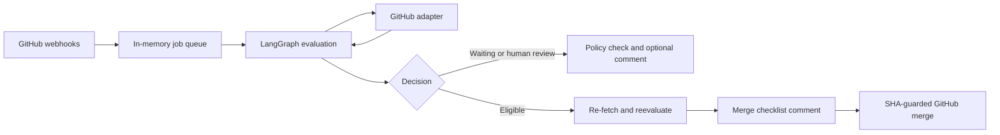

# Architecture

The agent separates GitHub transport, deterministic policy checks, reviewer interpretation, and optional LLM judgments. LangGraph orders one evaluation; an in-memory queue serializes webhook work.

## Evaluation

The graph in [`engine.py`](../src/auto_merge_agent/engine.py) has `fetch`, `static`, and optional `llm` nodes. A fresh run loads the effective config, PR metadata, changed files, CI check runs and commit statuses, and review artifacts. It applies mandatory gates before trying any eligibility rule:

1. Repo enabled; PR open, not draft, mergeable, and authored by a trusted account.
2. No blocking label or outstanding human change request; complete changed-file list.
3. Repo-wide line limit, expected CI, all observed non-ignored checks, and at least one passing non-ignored check. A reviewer status may serve as an additional check, but a named CI job must still be expected.
4. A completed CodeRabbit assessment for the current head, with merge risk and finding severity within the configured thresholds.
5. One matching static rule, followed by all of that rule's configured LLM sections.

Rules are OR alternatives after the mandatory gates. Within a rule, complexity and custom LLM sections are both required when present. Section line caps run before model calls. An eligible result records a checklist of passed gates; rejected or waiting results carry reasons.

Before merging, the service evaluates the PR again and verifies the head, base, and policy revision have not changed during its run. It posts the passed-check checklist, then calls GitHub's merge endpoint with the evaluated head SHA. A new head makes GitHub reject the request. The bot updates the checklist comment to show whether the merge succeeded or stopped. The `automerge/policy` check stays tied to the head SHA. See [GitHub's merge API](https://docs.github.com/en/rest/pulls/pulls).

GitHub Actions triggered by `pull_request` can attach checks to the test merge commit. The GitHub adapter reads checks on both that commit and the PR head. CodeRabbit review coverage is evaluated only against the head. See [GitHub's event reference](https://docs.github.com/en/actions/reference/workflows-and-actions/events-that-trigger-workflows).

## Extension points

| Component | Interface and registration | Current implementation |
| --- | --- | --- |
| Forge | `ForgePlugin`, `auto_merge_agent.forges` entry points | `GitHubForge` fetches PRs, diffs, checks, reviews, comments, and merges. |
| Reviewer | `ReviewerPlugin`, `auto_merge_agent.reviewers` entry points | `CodeRabbitReviewer` returns a normalized review state, risk, and findings. |
| Eligibility rule | `RuleEvaluator`, `auto_merge_agent.rules` entry points | `changed_paths_only`; reusable rules live in `profiles/`. |
| LLM model | LangChain `init_chat_model` using an allowlisted model ID | OpenAI through `langchain-openai` for the checked-in policy. |

The public types are in [`types.py`](../src/auto_merge_agent/types.py); plugin protocols and loading are in [`plugins.py`](../src/auto_merge_agent/plugins.py). The service selects the GitHub forge today. A GitLab adapter would also require event routing and config-host support; those pieces are not implemented.

The CodeRabbit adapter reads its summary comment, requires its reviewed-commit marker to match the current head, and associates inline findings with their submitted review rather than GitHub's movable comment `commit_id`. It also parses findings posted in a review body when they cannot be attached inline. Missing coverage, unparseable risk labels, and known potential-issue comments with unknown severity fail closed. Upstream format changes still need representative test cases. See [`reviews.py`](../src/auto_merge_agent/reviews.py).

LLM calls use structured Pydantic outputs for complexity and the custom `safe_to_merge` decision. PR titles, descriptions, file paths, and patches are treated as untrusted input. A rule needs full text patches; missing patches or oversized input require human review. A model error makes the evaluation wait. The configured custom prompt can restrict eligibility but cannot bypass mandatory gates. See [`llm.py`](../src/auto_merge_agent/llm.py).

## Runtime and observability

The FastAPI service verifies the webhook signature and queues only repositories with an enabled, valid config. PR events queue the PR directly; commit-status events first resolve their SHA to open PRs. A single worker processes deduplicated jobs in memory and schedules transient failures for retry with backoff. It scans configured open PRs at startup and every 15 minutes, recovering pending work lost on a restart or missed webhook. Run one service process; the queue is not shared across processes. See [`service.py`](../src/auto_merge_agent/service.py).

`AUTOMERGE_ACTIVE=false` prevents GitHub writes by the service. The CLI's `evaluate` command independently prints read-only JSON unless `--execute` is explicitly used. When `MLFLOW_TRACKING_URI` is configured, `mlflow.langchain.autolog()` records LangGraph and model traces in the selected MLflow experiment. Trace inputs may contain PR code or descriptions; control access to that experiment. See [MLflow's LangGraph integration](https://mlflow.org/docs/latest/genai/tracing/integrations/listing/langgraph). The service logs each reconciliation and PR decision at INFO level, including waiting reasons in shadow mode.

## Current limits

Only GitHub and CodeRabbit are implemented. CodeRabbit's publication format is an external dependency; parser changes should be tested against representative live PRs. The agent does not discover required checks from GitHub branch rules, so each enabled policy must name expected checks. It does not replace branch protection, review requirements, or a merge queue. A synchronous direct merge can still be rejected by GitHub. If updating the checklist after a confirmed merge fails, the pre-merge checklist remains and the service logs the error for an operator to inspect.
